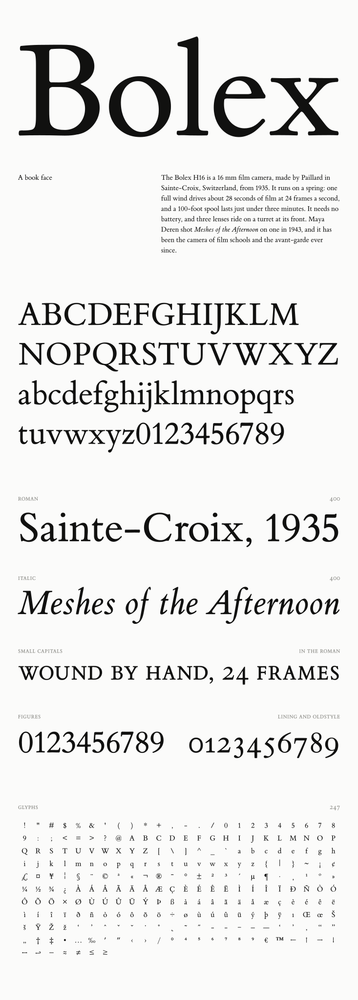

# Bolex



A book face for the web: a Roman with small capitals and an Italic, in one weight. The Bolex H16 is a spring-wound 16 mm film camera.

```css
@font-face { font-family: Bolex; src: url(Bolex-Roman.woff2); }
@font-face { font-family: Bolex; src: url(Bolex-Italic.woff2); font-style: italic; }
body { font: 20px/1.5 Bolex, serif; font-synthesis: none; }
abbr { font-variant-caps: all-small-caps; }
```

The Roman's figures are lining and proportional. CSS asks for the rest:

| | |
|---|---|
| Oldstyle or tabular figures | `font-variant-numeric: oldstyle-nums`, `tabular-nums` |
| Small capitals, in the Roman | `font-variant-caps: small-caps`, `all-small-caps` |
| Fractions, 3 1/2 to 3 ½ | `font-variant-numeric: diagonal-fractions` |
| Footnote figures | `font-variant-position: super` |
| Punctuation raised for capitals | `font-feature-settings: "case"` |

Kerning can't reach from one font into the other, so punctuation that touches an italic word goes inside its `<i>`.

Built in code from [ET Book](https://github.com/edwardtufte/et-book), copied into [`et-book/`](et-book): `uv run bolex` rewrites [`fonts/`](fonts).

[MIT](LICENSE).
